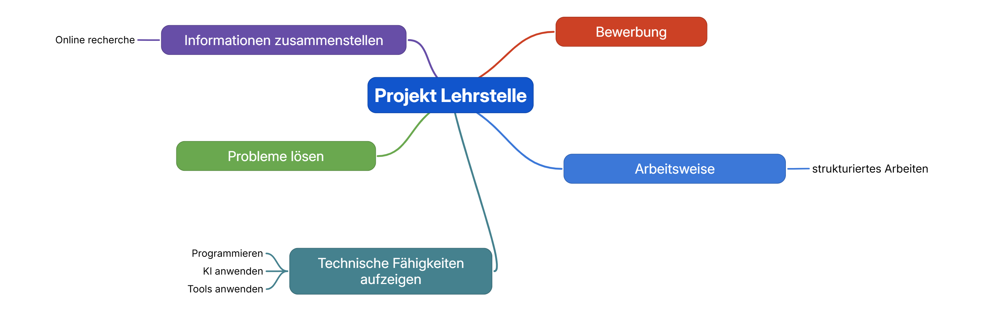

# Entwicklungsjournal – Projekt Lehrstelle

## 1. Allgemeine Informationen

**Projekt:** Projekt Lehrstelle  
**Projektart:** Persönliches Webentwicklungsprojekt  
**Entwickler:** Projektverantwortlicher  
**Beginn der dokumentierten Entwicklung:** 31. Oktober 2026

### Ziel des Entwicklungsjournals

In diesem Dokument halte ich die Entwicklung meines Projekts fest. Ich dokumentiere umgesetzte Funktionen, verwendete Technologien, Schwierigkeiten, Lösungsansätze und meine persönlichen Lernerfahrungen.

Das Journal soll nachvollziehbar zeigen, wie das Projekt entstanden ist und wie ich meine technischen Fähigkeiten weiterentwickelt habe.

---

## 2. Entwicklungsverlauf

### 31. Oktober 2026 – Projektstruktur und Planung

**Umgesetzte Arbeiten:**
- Bestehendes GitHub-Repository lokal in VS Code verwendet.
- Projektordner und grundlegende Verzeichnisstruktur erstellt.
- Ordner für CSS, JavaScript, Unternehmensdaten und Bilder angelegt.
- Die bestehenden Planungsdokumente überprüft.
- HTML-, CSS- und JavaScript-Grunddateien erstellt.

**Verwendete Technologien:**
- Visual Studio Code
- Git und GitHub
- HTML
- CSS
- JavaScript
- JSON

**Lernerfahrung:**

Ich habe gelernt, wie wichtig eine übersichtliche Projektstruktur für die weitere Entwicklung ist. Durch die Trennung von Programmcode, Daten und Dokumentation bleibt das Projekt besser organisiert.

---

### 31. Oktober 2026 – Entwicklung der Startseite

**Umgesetzte Arbeiten:**
- Grundgerüst der Startseite mit HTML erstellt.
- Navigation und verschiedene Inhaltsbereiche eingebaut.
- Dunkles Design mit blauen Akzenten umgesetzt.
- Responsive CSS-Grundlagen ergänzt.
- Erste visuelle Kontrolle der Website im Browser durchgeführt.

**Schwierigkeiten:**

Zu Beginn musste ich die HTML-Struktur mit den passenden CSS-Klassen verbinden.

**Lernerfahrung:**

Ich habe gelernt, wie HTML die Struktur einer Website vorgibt und CSS für das Aussehen und Layout verantwortlich ist.

---

### 31. Oktober 2026 – Erste Unternehmensdaten

**Umgesetzte Arbeiten:**
- Erste Unternehmensdatei `schweizer-armee.json` erstellt.
- Informationen zur Lehrstelle Informatiker/-in EFZ, Fachrichtung Plattformentwicklung, eingetragen.
- Deutsche und englische Inhalte vorbereitet.
- Fünf festgelegte Kapitel in der Datenstruktur umgesetzt.
- Quellenverzeichnis ergänzt.

**Lernerfahrung:**

Ich habe gelernt, wie JSON-Daten strukturiert werden und weshalb es sinnvoll ist, Unternehmensinformationen getrennt vom eigentlichen Programmcode zu speichern.

---

### 31. Oktober 2026 – Dynamische Unternehmensprofile

**Umgesetzte Arbeiten:**
- JavaScript zum Laden der Unternehmensdaten programmiert.
- Unternehmenskarte automatisch aus JSON-Daten erstellt.
- Verlinkung zur individuellen Profilseite umgesetzt.
- Profilseite mit fünf Kapiteln entwickelt.
- Deutsche und englische Sprachumschaltung eingebaut.
- Quellen automatisch auf der Profilseite angezeigt.

**Schwierigkeiten:**

Die JSON-Daten konnten zunächst nicht direkt über den Browser geladen werden. Anschliessend wurde die Website über Live Server getestet.

**Lernerfahrung:**

Ich habe gelernt, wie JavaScript mit `fetch()` Daten aus JSON-Dateien laden und diese dynamisch auf einer Website darstellen kann.

---

### 1. November 2026 – Unternehmensübersicht erweitern

**Umgesetzte Arbeiten:**
- Zentrale Datei `data/firmen/index.json` erstellt.
- Unternehmensliste auf eine zentrale Datenquelle umgestellt.
- JavaScript so angepasst, dass mehrere Unternehmensdateien geladen werden können.
- Unternehmenskarte weiterhin erfolgreich im Browser angezeigt.

**Aufgetretenes Problem:**

Zunächst konnten die Unternehmensprofile nicht geladen werden.

**Ursache und Lösung:**

Der Eintrag in der neuen `index.json` hatte zunächst gefehlt. Nachdem ich die Unternehmens-ID `schweizer-armee` ergänzt hatte, funktionierte das Laden wieder.

**Lernerfahrung:**

Ich habe gelernt, wie wichtig korrekte Dateinamen, Pfade und Datenstrukturen sind. Ausserdem konnte ich einen Fehler beim Laden der Daten selbstständig eingrenzen und beheben.

---

## 3. Verwendete Hilfsmittel

| Hilfsmittel | Verwendung |
|---|---|
| Visual Studio Code | Programmierung und Projektverwaltung |
| Git | Versionsverwaltung |
| GitHub | Speicherung des Projekts |
| ChatGPT | Unterstützung beim Lernen, Planen, Programmieren und Debugging |
| Gemini | Ergänzende KI-Unterstützung |
| Live Server | Lokale Darstellung und Tests der Website |

## 4. Persönliche Lernerfahrungen

Während der bisherigen Entwicklung habe ich folgende Kenntnisse aufgebaut und vertieft:

- Strukturierung von Webprojekten
- HTML-Grundstruktur und semantische Elemente
- CSS-Layouts und Responsive Design
- JavaScript-Funktionen und DOM-Manipulation
- Laden und Verarbeiten von JSON-Daten
- Verwendung von URL-Parametern
- Fehleranalyse und Debugging
- Versionsverwaltung mit Git und GitHub
- Dokumentation eines Softwareprojekts

## 5. Offene Arbeiten

Folgende Aufgaben stehen noch an:

- Weitere Unternehmensprofile hinzufügen.
- Unternehmensinformationen anhand offizieller Quellen überprüfen.
- Design und Benutzerfreundlichkeit weiter verbessern.
- Darstellung auf verschiedenen Bildschirmgrössen testen.
- Dokumentation vervollständigen.
- Website auf GitHub Pages veröffentlichen.
- Abschliessende Funktionstests durchführen.

## 6. Laufende Dokumentation

Für jeden weiteren Entwicklungsschritt wird ein neuer Eintrag ergänzt.

**Vorlage für neue Einträge:**

### [Datum] – [Titel des Entwicklungsschritts]

**Umgesetzte Arbeiten:**
- 

**Schwierigkeiten:**
- 

**Lösungsansätze:**
- 

**Lernerfahrung:**
- 

**Nächste Schritte:**
- 
## Entwicklungsfortschritt – Zweisprachigkeit und Veröffentlichung

### 1. Unternehmensprofile dynamisch laden
Ich habe die Unternehmensprofile so aufgebaut, dass sie über eine zentrale JSON-Datei (`data/firmen/index.json`) gefunden und dynamisch geladen werden. Dadurch können später weitere Unternehmen ergänzt werden, ohne die gesamte Website neu programmieren zu müssen.

### 2. Zweisprachige Unternehmensprofile
Ich habe die Unternehmensdaten auf Deutsch und Englisch in JSON gespeichert. Die Profilseite liest die gewünschte Sprache aus der URL aus. Dadurch kann dasselbe Profil in zwei Sprachen angezeigt werden.

### 3. Veröffentlichung mit GitHub Pages
Ich habe das Projekt über GitHub Pages veröffentlicht. Anschliessend habe ich die Website auf einem Mobiltelefon getestet und überprüft, ob die wichtigsten Funktionen online funktionieren.

### 4. Zweisprachige Startseite
Ich habe die Startseite ebenfalls auf Deutsch und Englisch erweitert. Dafür habe ich eine neue JavaScript-Datei (`js/home-language.js`) erstellt, welche die passenden Texte anhand des URL-Parameters `lang` einsetzt.

### 5. Sprachabhängige Unternehmensübersicht
Ich habe `js/main.js` angepasst. Die Unternehmensübersicht verwendet jetzt die passende Sprachversion der Firmendaten. Auch die Links zu den Unternehmensprofilen übernehmen die ausgewählte Sprache.

### 6. Testen und Fehlerbehebung
Ich habe die deutsche und englische Startseite sowie die Unternehmensprofile getestet. Dabei habe ich kontrolliert, ob die Texte, Unternehmensinformationen und Sprachwechsel korrekt funktionieren.

### 7. GitHub und Versionsverwaltung
Nach den Änderungen habe ich die Dateien mit Git gespeichert und zu GitHub hochgeladen. So bleibt der aktuelle Entwicklungsstand online und die Änderungen sind nachvollziehbar.

### Was ich dabei gelernt habe
- JSON-Daten können für mehrere Sprachversionen verwendet werden.
- JavaScript kann die Sprache anhand von URL-Parametern erkennen.
- Mit `URLSearchParams` lassen sich Parameter aus einer URL auslesen.
- Mit `fetch()` können JSON-Dateien dynamisch geladen werden.
- Git und GitHub helfen dabei, Änderungen zu speichern und zu veröffentlichen.
- Eine Website muss nicht nur lokal, sondern auch online und auf mobilen Geräten getestet werden.